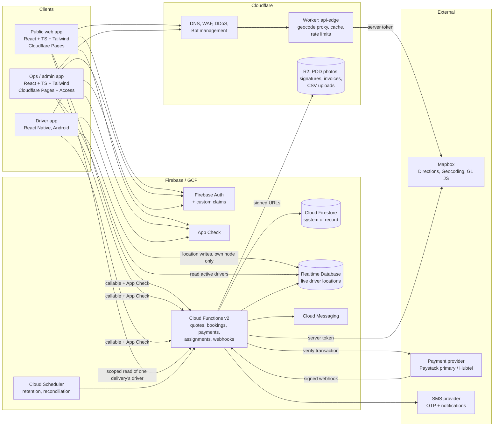

# 1. System Architecture

## 1.1 Business model constraints that shape the architecture

- **Single operator.** The company owns the vehicles, employs the drivers and runs the hubs. There is no marketplace, no driver bidding and no third-party carriers. Every assignment decision is made (or approved) by internal dispatch staff.
- **Customers book directly.** Guests may book without an account; registered customers and verified businesses get dashboards.
- **Nationwide, but launched in selected service areas.** Every operational entity (service area, hub, route, pricing rule) is data, not code, so new cities are added by configuration.
- **Money and custody are the highest-risk data.** Prices, payments and delivery custody records are written only by trusted server code and are append-only or versioned.

## 1.2 The six interfaces

| # | Interface | Users | Delivered by | Phase |
|---|-----------|-------|--------------|-------|
| 1 | Public booking website | Anyone (guest) | `apps/web` (public routes) | 1 |
| 2 | Customer account & tracking dashboard | `customer` | `apps/web` (`/account`, `/track`) | 2 |
| 3 | Seller & business dashboard | `business_owner`, `business_staff` | `apps/web` (`/business`) | 5 |
| 4 | Driver mobile application | `driver` | `apps/driver-app` (React Native, Android first) | 3 |
| 5 | Central dispatch dashboard | `dispatcher`, `hub_operator` | `apps/admin-tools` (`/dispatch`) | 3–4 |
| 6 | Administrative, financial & fleet dashboard | `admin`, `finance`, `fleet_manager`, `super_admin` | `apps/admin-tools` (`/admin`) | 2–6 |

Interfaces 1–3 share one public web app because they share branding, booking components and the customer auth session. Interfaces 5–6 share an internal app (`apps/admin-tools`) that is deployed to a **separate hostname** (e.g. `ops.example.com.gh`) protected by Cloudflare Access in addition to Firebase Auth + MFA. This keeps staff-only code out of the public bundle.

## 1.3 Technical architecture diagram

## 1.4 Responsibilities by layer

**Clients** render UI, collect input, and display server-produced data. They never compute an authoritative price, never mark a payment as paid, never set their own role, and never write delivery status directly. A client-side price preview may be displayed, but the server recomputes and the server's figure is what is stored.

**Cloudflare**
- Pages hosts the static builds of `apps/web` and `apps/admin-tools`.
- DNS, WAF and rate-limiting rules protect all hostnames.
- `workers/api-edge` proxies Mapbox geocoding so that the browser never receives an unrestricted token, caches results (Ghanaian addresses repeat heavily), and enforces per-IP limits. It is the place to swap map providers without redeploying clients.
- R2 stores binary evidence (POD photos, signatures), generated invoices/receipts and business CSV uploads. Uploads use short-lived signed URLs issued by Cloud Functions after an authorization check; buckets are never public.

**Firebase**
- **Auth** identifies every user. Roles live in **custom claims** that only Cloud Functions running as admin can set.
- **App Check** (Play Integrity on Android, reCAPTCHA Enterprise on web) is enforced on all callable functions and on Firestore/RTDB.
- **Cloud Functions** contain all business logic that touches money, custody, roles or pricing. Every function validates input with the shared `zod` schemas from `packages/validation`.
- **Firestore** is the system of record (bookings, deliveries, legs, payments, audit logs).
- **Realtime Database** holds only *ephemeral* active-driver location streams (cheap, high-frequency writes, low-latency listeners). It is never the source of truth for custody or status.
- **FCM** delivers push notifications to drivers and logged-in customers.

**External**
- **Mapbox** behind a `MapProvider` interface (`packages/shared-utils/src/geo`), so Directions/Geocoding can be replaced (e.g. by Google, HERE or OSRM) by implementing one adapter.
- **Payments** behind a `PaymentProvider` interface (Phase 2). Paystack is the recommended primary; Hubtel the recommended secondary (see `07-payments.md`).
- **SMS** for OTP proof-of-delivery codes and status messages to recipients who have no app.

## 1.5 Key architectural decisions

| Decision | Reason |
|----------|--------|
| Money stored as **integer pesewas** (1 GHS = 100 pesewas) | Avoids floating point errors in prices, refunds and reports. |
| **Server-authoritative pricing** with an immutable price snapshot on every booking | Spec §6: preserve confirmed price and breakdown; prevents tampering. |
| **Versioned pricing rules** (`pricingRules/{version}`, one `active` pointer) | A booking references the exact rule version used; rules can change without altering history. |
| **Delivery state machine** shared by server and clients (`shared-utils/lifecycle`) | One definition of legal transitions; server rejects illegal ones. |
| **Shipment legs** model custody explicitly | Intercity packages move through hubs and vehicles; live location is shown only for the leg whose holder is a driver currently in an active session (spec §5: never show an inaccurate driver location). |
| **Custom claims for roles**, mirrored in `users/{uid}.role` for display only | Claims are tamper-proof in rules; Firestore copy is server-written. |
| **Cloud Functions bundled with esbuild** | Lets functions consume workspace packages without publishing them, and keeps cold starts small. |
| Region `europe-west1` for Functions, Firestore and RTDB | RTDB is only available in `us-central1`, `europe-west1`, `asia-southeast1`; co-locating all three with the lowest latency to Ghana. Revisit `africa-south1` for Firestore/Functions if RTDB is not needed in the same region. |
| Separate ops hostname behind Cloudflare Access | Defence in depth for staff tools. |

## 1.6 Environments

| Environment | Firebase project | Cloudflare | Purpose |
|-------------|------------------|-----------|---------|
| `local` | Emulator Suite | `wrangler dev` | Development and automated tests |
| `staging` | `<company>-courier-staging` | Pages preview + staging Worker | UAT, payment sandbox keys |
| `production` | `<company>-courier-prod` | Pages production + production Worker | Live |

Production and staging never share secrets, payment keys or Mapbox tokens.
