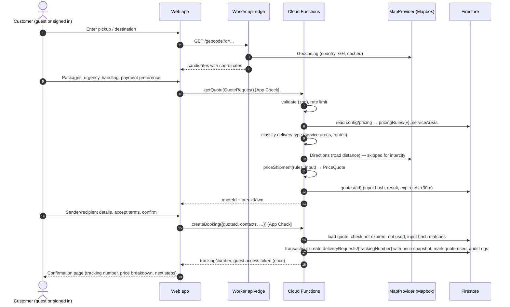

# 4. Booking Workflow & Pricing

## 4.1 Booking workflow



Rules:
1. **Accounts are optional.** Guests receive a tracking number and a one-time access token (shown once, also sent by SMS in Phase 2). Only a SHA-256 hash of the token is stored.
2. **The server classifies the delivery type** from the addresses:
   - pickup and destination inside the same active service area → `intra_city`
   - pickup and destination in different service areas connected by an active intercity route price → `intercity`
   - otherwise, if long-distance service is enabled and the distance is within its limit → `long_distance`
   - pickup outside every active service area → rejected (`PICKUP_NOT_SERVICED`)
   The customer sees and confirms the determined type before booking.
3. **The confirmed price is immutable.** `deliveryRequests.price` stores the full `PriceQuote` (every line, pricing version, distance and its source). Later price-rule changes never alter it. Adjustments (e.g. weight discrepancy found at pickup) are separate, audited `priceAdjustments` handled by staff (Phase 3).
4. **Quotes expire after 30 minutes and are single use.** The booking must present the same addresses and packages that were quoted (hash comparison); otherwise it must re-quote.
5. **Payment** (Phase 2): if `paymentPreference` is `mobile_money` or `card`, the booking starts `pending_payment` and becomes `confirmed` only after server-side verification. In Phase 1, before payment integration exists, online preferences are recorded and the booking is created as `pending_payment` with `paymentStatus: unpaid`; dispatch staff confirm manually. `cash_on_pickup` bookings start `confirmed`. `business_invoice` is only accepted for verified businesses with approved credit (Phase 5).

## 4.2 Pricing model

All amounts are integer pesewas. The engine is a pure function, `priceShipment(rules, input)` in `packages/shared-utils/src/pricing`, used by the server (authoritative) and safe to use in clients for previews.

### Inputs
- `rules: PricingRuleSet` — the active version.
- `deliveryType`, `distanceKm` (road distance; omitted for intercity), `route` (for intercity).
- `packages[]` — weight, dimensions, quantity, declared value.
- `urgency`, `specialHandling[]`, optional `contract` (business contract pricing).

### Step-by-step

1. **Chargeable weight** per package = `max(actualKg, L×W×H / volumetricDivisor)` × quantity, summed. Default divisor 5000 cm³/kg.
2. **Vehicle class** (intra-city & long-distance): the smallest class in `motorbike → car → van → truck` whose `maxWeightKg` ≥ total chargeable weight and `maxDimensionCm` ≥ the largest single package dimension, and which is enabled for the delivery type. None fits → `NO_SUITABLE_VEHICLE` (refer to sales).
3. **Transport charge**
   - `intra_city`: `base[class] + max(0, distanceKm − includedKm[class]) × perKm[class]` — the "fixed intra-city price" is the base covering the included kilometres.
   - `long_distance`: `base[class] + distanceKm × perKm[class]`, at least `minimumPesewas`.
   - `intercity`: the route's fixed price `basePesewas` + `firstMilePesewas` + `lastMilePesewas`.
4. **Weight charge**
   - `intra_city` / `long_distance`: chargeable kg above `weight.includedKg`, priced by bands (`[{ upToKg, perKgPesewas }]`, last band open-ended).
   - `intercity`: kg above the route's `includedWeightKg` × route `perExtraKgPesewas`.
5. **Urgency fee**: `express` and `same_day` each have `percent` (of transport + weight) and `minimumPesewas`. `same_day` is only offered for `intra_city`.
6. **Special handling**: fixed fee per flag; `high_value` additionally charges `percent` of total declared value with a minimum (cover fee).
7. **Discounts** on transport + weight charges only:
   - bulk: highest tier whose `minPackages` ≤ total quantity,
   - business contract: `discountPercent`, and/or intercity `routeOverrides` replacing the route base price,
   - combined percentage capped at `maxDiscountPercent`.
8. **Minimum charge**: if the post-discount subtotal is below `minimumChargePesewas`, a top-up line is added.
9. **Taxes**: each configured tax (`{ code, label, percent }`) applied to the post-discount subtotal. Ships empty: tax treatment (VAT, NHIL, GETFund) must be confirmed with the company's tax advisor before enabling.
10. Percentages are applied with `Math.round` per line, so `total = Σ lines` exactly.

### Output (`PriceQuote`)
```ts
{
  pricingVersion, currency: 'GHS', deliveryType, vehicleClass | null,
  distanceKm | null, distanceSource: 'route' | 'estimated' | 'fixed_route',
  chargeableWeightKg, totalQuantity,
  lines: [{ code, label, amountPesewas }],   // discounts are negative
  subtotalPesewas, discountPesewas, taxPesewas, totalPesewas
}
```

### Distance source
The server asks the `MapProvider` for driving distance. If the provider fails and `rules.distance.allowEstimateFallback` is true, the server uses great-circle distance × `estimateRoadFactor` (default 1.35) and marks the quote `distanceSource: 'estimated'`, which is shown to the customer and flagged to dispatch. If fallback is disabled, the quote fails with `DISTANCE_UNAVAILABLE`.

## 4.3 Managing prices

- Admins edit a **draft** rule set in the ops app (Phase 2+) or via `scripts/publish-pricing` (Phase 1).
- `publishPricingRules` validates the full set with `pricingRuleSetSchema`, writes `pricingRules/{nextVersion}` as `active`, marks the previous version `superseded`, updates `config/pricing.activeVersion` atomically, and logs to `auditLogs`.
- Sample values in `firebase/seed/pricing-rules.sample.json` are **illustrative only**; management must set real prices before launch.
