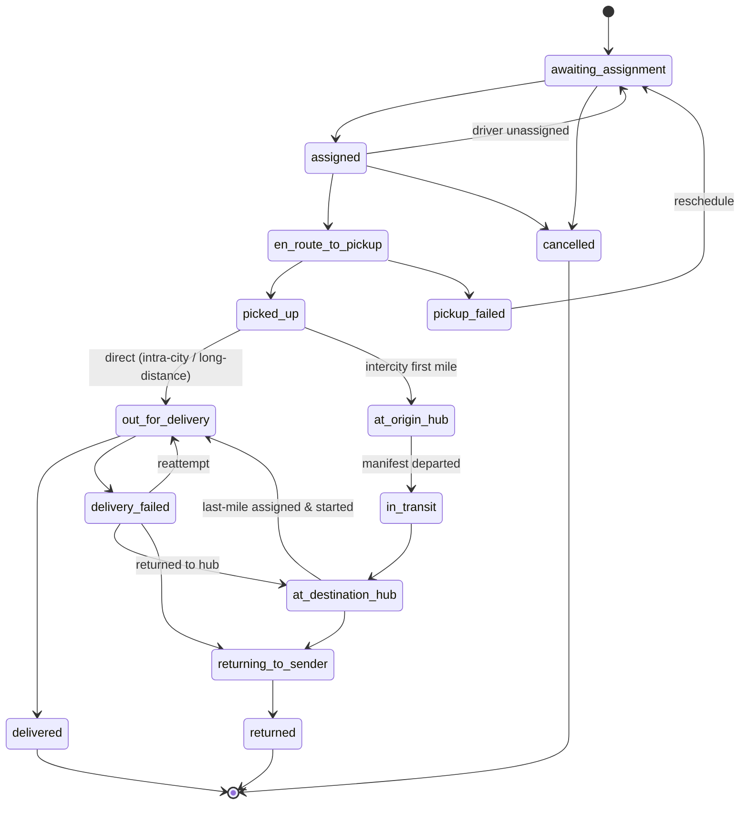

# 5. Delivery Lifecycle

## 5.1 Two layers of status

- **Booking status** (`deliveryRequests.status`): `pending_payment → confirmed → (converted)` or `cancelled`.
- **Delivery status** (`deliveries.status`): operational state for the whole shipment.
- **Leg status** (`shipmentLegs.status`): custody state of each segment.

The delivery status is derived from leg progress by server functions; drivers and hub operators trigger leg events, never set the delivery status directly.

## 5.2 Delivery state machine

Defined once in `packages/shared-utils/src/lifecycle` and enforced by Cloud Functions.

Any non-terminal state may additionally move to `on_hold` (exception raised by dispatch) and back to the state it came from.

## 5.3 Shipment legs

| Delivery type | Legs |
|---|---|
| intra_city | 1 × `direct` (pickup address → destination address) |
| long_distance | 1 × `direct`, or split into legs by dispatch for driver hand-over at a hub |
| intercity | `first_mile` (pickup → origin hub) · `linehaul` (origin hub → destination hub, on a manifest) · `last_mile` (destination hub → recipient) |

A customer may drop off at a hub (no first-mile leg) or collect from a hub (no last-mile leg) — Phase 4 options.

## 5.4 Custody and scanning

Every hand-over is a scan event with the actor's identity:
1. Driver scans parcel label QR at pickup → leg `in_progress`, delivery `picked_up`.
2. Hub operator scans in → first-mile leg `completed`, custodian becomes `hub`.
3. Parcel added to manifest; manifest sealed; departure scan → linehaul leg `in_progress`, custodian `vehicle`.
4. Arrival scan at destination hub → linehaul `completed`, custodian `hub`.
5. Last-mile driver scans out → last-mile `in_progress`, custodian `driver`.
6. Proof of delivery captured → leg and delivery `completed`/`delivered`.

**Live location rule:** the customer-facing tracking view shows a driver position only when `currentCustodian.type == 'driver'`, that driver's assignment for the current leg is `started`, and `/activeTracking/{deliveryId}.authorizedUntil > now`. When the parcel is at a hub, the view shows the hub; when it is on a linehaul vehicle, it shows "In transit Accra → Kumasi" with the vehicle's last checkpoint, never a final-mile driver's position.

## 5.5 Proof of delivery

- **OTP** (default): a 6-digit code generated at last-mile start, sent by SMS to the recipient, hashed in `podSecrets`. Max 5 attempts; then dispatch may authorise an alternative.
- **Signature**: captured on device, uploaded to R2 via signed URL.
- **Photo**: required for `high_value` and for "left with neighbour/security" outcomes.
- GPS position and timestamp captured with every POD; POD more than a configurable distance (default 300 m) from the destination is flagged as an exception.

## 5.6 Exceptions

`pickup_failed`, `delivery_failed` require a reason code (`recipient_unavailable`, `wrong_address`, `refused`, `damaged`, `access_denied`, `weather`, `vehicle_breakdown`, `other`) plus optional photo. Dispatch sees exceptions on the board and decides reattempt, return or hold. Deliveries past `expectedDeliveryAt` are flagged as delayed by a scheduled function.
